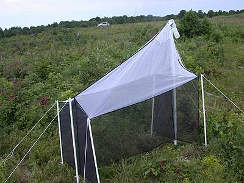
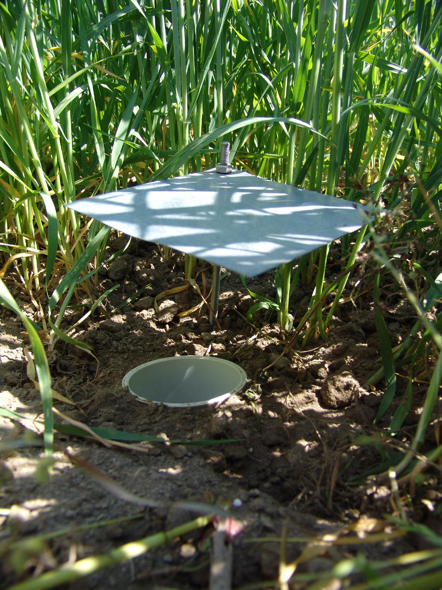

```{r}
#| echo: false

# Simulate the hypothetical arthropod data 
set.seed(123)

sites <- paste0("site_", 1:10)
map <- runif(10, 10, 100)
species <- paste0("species_", 1:3)

dat <- data.frame(site = rep(sites, each = 3),
                  MAP = rep(map, each = 3),
                  species = rep(species, times = 10))

# per-species mass increases with rainfall; pitfalls catch a bit more
dat$total_mass_malaise <- 5 + 0.1 * dat$MAP + rnorm(nrow(dat), 0, 1.5)
dat$total_mass_pitfall <- 6.5 + 0.1 * dat$MAP + rnorm(nrow(dat), 0, 1.5)
```

## Working through an example


Let's imagine we have data on arthropod biomass from two different collection methods: malaise traps and pitfalls. Malaise traps are particularly good at capturing flying insects. Pitfall traps are particularely good at capturing arthropods that crawl or burrow in the leaf litter.  

::: {#fig-traps layout-ncol=2 fig-pos="h" layout-align="center"}

{height="170pt"}


{height="170pt" fig-align="right"}

Types of arthropod traps
:::

For simplicity we will imagine there are only 3 arthropod species, 10 field sites, and 1 environmental measurement (mean annual precipitation = MAP).

We don't actually have these data, but we can make some up with simulation and store those data in a data.frame called `dat`. After simulating data, this is what they might look like:

```{r}
head(dat)
```

To develop questions, scientific hypotheses, and predictions we don't even need to see the data itself, we just need to know what the variables are and, ideally, something about how the data were collected. For our pretend data in this example that info is

```{r}
#| echo: false

data.frame(
    Variable = paste0("`", names(dat), "`"), 
    Description = 
        c(
            "name of sampling location, 10 locations total", 
            "mean annual precipitation in cm",
            "species name of arthropod found in sample, 3 species found at each location",
            "total biomass (g) in the malaise trap for a given species at a given location",
            "total biomass (g) in the pitfall trap for a given species at a given location"
        )
) |> 
    knitr::kable(format = "markdown", padding = 4)
```

Now we can think of some questions, scientific hypotheses, and predictions.

### Question 1: how does total arthropod biomass respond to rainfall?

There is our first example question "how does total arthropod biomass respond to rainfall?". Now the next step: based on biology, what would we hypothesize to be the relationship between biomass and rainfall? It could be that water is limiting for plant growth and because plants are the primary producers, what increases their growth (i.e. biomass) will increase the biomass of secondary consumers. So we could hypothesize that

> H1: total arthropod biomass increases with more rainfall.

From this hypothesis we can, lastly, state a prediction.

> Prediction 1: If increased rainfall allows for more arthropod biomass, then across samples we should see greater values of total biomass where rainfall is higher, and smaller values of total biomass where rainfall is less.


The question, scientific hypothesis, and prediction is all we need for now! But the assignment does say we need two questions, so here is another:


### Question 2: Does one sampling method, malaise traps or pitfalls, more effectivly catch species 1?

Suppose species 1 was some particular species of interest or concern, for example a pest like coconut rhinoceros beetle. We might want to ask if one sampling method is better at detecting it. Based on the biology of that species, we could hypothesis, for example, that pitfalls are more effective, so

> H2: Pitfall traps are more effective at catching species 1.

Now we make a prediction of what the data would look like if that hypothesis were true:

Prediction 2: If pitfall traps are more effective at catching species 1, then samples from pitfall traps should have higher biomass for species 1 than samples from malaise traps.

## Why go through these steps?

You might be asking that question. These steps of question, hypothesis, prediction, set us up for the rest of our analysis. With the prediction in hand we can make a clear plan for how to visualize the data (the next assignment). With the visualization and scientific hypothesis we can figure out the most appropriate statistical null hypothesis test and confidence interval approach to take (the next, next assignment).

