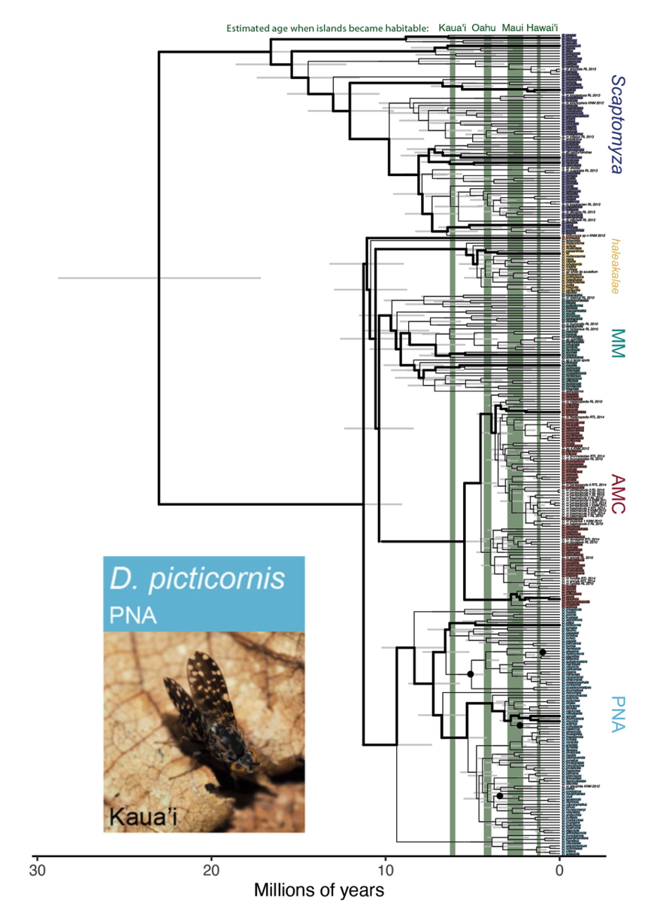

```{r setup, include=FALSE}
knitr::opts_chunk$set(echo = FALSE, warning = FALSE,
                      message = FALSE, eval = TRUE)

library(cowplot)
library(ggplot2)
library(viridis)
```

## Are older insect lineages more species rich in Hawaiʻi?

::: columns
::: {.column width="50%"}
*Hylaeus* bees

- 700,000 years
- 60-ish species

{width="40%"}
:::

::: {.column width="50%"}
Native *Drosophila*

- 25 million years
- possibly 1000 species

{width="30%"}
:::
:::

## Are older insect lineages more species rich in Hawaiʻi?

Looks like it...a question for [correlation]{.alert}

```{r}
#| fig-align: center
#| fig-width: 4
#| fig-height: 3
#| out-width: "6.5in"

hi_insect <- read.csv("../data/hembry_etal.csv")
hi_insect$clade_richness <- round(hi_insect$clade_richness)

ggplot(hi_insect, aes(x = clade_age, y = clade_richness)) +
    geom_point() +
    theme_cowplot() +
    xlab("Clade age (my)") +
    ylab("Number of species")
```

## Are older insect lineages more species rich in Hawaiʻi?

Using product-moment [correlation]{.alert}, we got a "significant" correlation

```{r}
cor.test(hi_insect$clade_age, hi_insect$clade_richness)
```

## Are older insect lineages more species rich in Hawaiʻi?

The significant correlation means that clade age and number of species have a [predictive]{.alert} relationship (I could predict one from the other).

How do we actually predict number of species from clade age?

::: columns
::: {.column width="50%"}
```{r}
#| fig-align: center
#| fig-width: 4
#| fig-height: 3
#| out-width: "5in"

hi_insect <- read.csv("../data/hembry_etal.csv")
hi_insect$clade_richness <- round(hi_insect$clade_richness)

ggplot(hi_insect, aes(x = clade_age, y = clade_richness)) +
    geom_point() +
    theme_cowplot() +
    xlab("Clade age (my)") +
    ylab("Number of species") +
    geom_smooth(method = "lm", se = FALSE)
```
:::

::: {.column width="50%"}
*A job for [regression]{.alert}*
:::
:::

## Learning Objectives

1. Use linear regression to predict $Y$ based on $X$
2. Test the null hypothesis of slope = 0
3. Display uncertainty in predictions from a linear regression
4. Use diagnostic plots to evaluate if data meet assumptions of regression


```{r helpers}
#| include: false

# ---- shared look ------------------------------------------------------------

line_col <- "steelblue"
pt_col <- "tomato"

theme_slides <- function() {
    theme_cowplot() +
        theme(
            axis.text = element_text(size = 18),
            axis.title = element_text(size = 22),
            strip.text = element_text(size = 20),
            plot.title = element_text(size = 22)
        )
}

xlab_i <- expression(italic(X))
ylab_i <- expression(italic(Y))

# ---- correlation vs regression panels ---------------------------------------

# n points with sample correlation exactly r and sample slope exactly b
sim_rb <- function(n, r, b, a = 15) {
    x <- as.numeric(scale(rnorm(n)))
    z <- as.numeric(scale(resid(lm(rnorm(n) ~ x))))
    sigma <- b * sqrt(1 / r ^ 2 - 1)
    data.frame(x = x, y = a + b * x + sigma * z)
}

set.seed(20211027)
panel_names <- c("Example 1\nr is BIG (0.84)\nb is small (0.33)",
                 "Example 2\nr is small (0.35)\nb is BIG (1.36)")
cr_df <- rbind(
    data.frame(sim_rb(100, 0.84, 0.33), panel = panel_names[1]),
    data.frame(sim_rb(100, 0.35, 1.36), panel = panel_names[2])
)
cr_df$panel <- factor(cr_df$panel, levels = panel_names)

# rise and run span the whole range of x in each panel
cr_tri <- data.frame(
    panel = factor(panel_names, levels = panel_names),
    b = c(0.33, 1.36)
)
cr_tri$x0 <- as.numeric(tapply(cr_df$x, cr_df$panel, min))
cr_tri$x1 <- as.numeric(tapply(cr_df$x, cr_df$panel, max))
cr_tri$y0 <- 15 + cr_tri$b * cr_tri$x0
cr_tri$y1 <- 15 + cr_tri$b * cr_tri$x1

cr_plot <- function(triangle = FALSE) {
    p <- ggplot(cr_df, aes(x, y)) +
        facet_wrap(vars(panel)) +
        geom_point(size = 2) +
        geom_smooth(method = "lm", formula = y ~ x, se = FALSE,
                    color = "firebrick", linewidth = 1.5)
    if (triangle) {
        p <- p +
            geom_segment(data = cr_tri, aes(x = x0, xend = x1, y = y0, yend = y0),
                         linewidth = 2.5) +
            geom_segment(data = cr_tri, aes(x = x1, xend = x1, y = y0, yend = y1),
                         linewidth = 2.5, color = line_col) +
            geom_text(data = cr_tri, aes(x = (x0 + x1) / 2, y = y0 - 1.8, label = "run"),
                      size = 7) +
            geom_text(data = cr_tri, aes(x = x1 + 0.1, y = (y0 + y1) / 2, label = "rise"),
                      size = 7, hjust = 0, color = line_col)
    }
    p +
        coord_cartesian(xlim = c(-3.5, 3.9), ylim = c(3, 27)) +
        xlab(xlab_i) +
        ylab(ylab_i) +
        theme_slides()
}

# ---- simple simulated x vs y (y increases with x) ---------------------------

set.seed(20211027)
sim_df <- data.frame(x = runif(14, 0, 10))
sim_df$y <- 2 + 0.8 * sim_df$x + rnorm(14, sd = 1.2)
sim_model <- lm(y ~ x, data = sim_df)
a_sim <- unname(coef(sim_model)[1])
b_sim <- unname(coef(sim_model)[2])
k_sim <- which.max(residuals(sim_model))

# stage 1: a data point; 2: its prediction; 3: intercept; 4: slope; 5: residual
nomen_plot <- function(stage = 1) {
    xi <- sim_df$x[k_sim]
    yi <- sim_df$y[k_sim]
    yhat <- unname(fitted(sim_model)[k_sim])
    ymax <- ceiling(max(sim_df$y)) + 1
    ybreaks <- yi
    ylabs <- expression(Y[i])
    if (stage >= 2) {
        ybreaks <- c(yhat, yi)
        ylabs <- expression(hat(Y)[i], Y[i])
    }

    p <- ggplot(sim_df, aes(x, y))
    if (stage >= 2) {
        p <- p + geom_abline(intercept = a_sim, slope = b_sim,
                             color = line_col, linewidth = 1.3)
    }
    p <- p +
        geom_point(color = pt_col, size = 4) +
        annotate("point", x = xi, y = yi, shape = 1, size = 8, stroke = 1.5) +
        annotate("segment", x = xi, xend = xi, y = 0, yend = yi, linetype = "dotted") +
        annotate("segment", x = -0.5, xend = xi, y = yi, yend = yi, linetype = "dotted")

    if (stage >= 2) {
        p <- p +
            annotate("point", x = xi, y = yhat, size = 4) +
            annotate("segment", x = -0.5, xend = xi, y = yhat, yend = yhat,
                     linetype = "dotted")
    }
    if (stage >= 3) {
        p <- p +
            annotate("point", x = 0, y = a_sim, size = 5) +
            annotate("text", x = 0.45, y = a_sim - 0.6, label = "a", size = 9)
    }
    if (stage >= 4) {
        x0 <- 4
        y0 <- a_sim + b_sim * x0
        y1 <- a_sim + b_sim * (x0 + 1)
        p <- p +
            annotate("segment", x = x0, xend = x0 + 1, y = y0, yend = y0,
                     linewidth = 1.2) +
            annotate("segment", x = x0 + 1, xend = x0 + 1, y = y0, yend = y1,
                     linewidth = 1.2, color = "firebrick") +
            annotate("text", x = x0 + 0.5, y = y0 - 0.6, label = "run = 1", size = 6) +
            annotate("text", x = x0 + 1.15, y = (y0 + y1) / 2, label = "rise = b",
                     size = 6, hjust = 0, color = "firebrick")
    }
    if (stage >= 5) {
        p <- p +
            annotate("segment", x = xi, xend = xi, y = yhat, yend = yi,
                     linewidth = 1.5, color = "firebrick") +
            annotate("text", x = xi + 0.25, y = (yhat + yi) / 2, label = "e[i]",
                     parse = TRUE, size = 8, hjust = 0, color = "firebrick")
    }

    p +
        scale_x_continuous(breaks = xi, labels = expression(X[i]), 
                           expand = 0) +
        scale_y_continuous(breaks = ybreaks, labels = ylabs) +
        coord_cartesian(xlim = c(-0.5, 10.5), ylim = c(0, ymax), expand = FALSE) +
        xlab(xlab_i) +
        ylab(ylab_i) +
        theme_slides()
}

# zoomed-in view of one residual
zoom_plot <- function() {
    xi <- sim_df$x[k_sim]
    yi <- sim_df$y[k_sim]
    yhat <- unname(fitted(sim_model)[k_sim])
    ymid <- (yi + yhat) / 2
    ggplot() +
        geom_abline(intercept = a_sim, slope = b_sim, color = line_col, linewidth = 1.5) +
        annotate("segment", x = xi, xend = xi, y = yhat, yend = yi,
                 linewidth = 1.5, color = "firebrick") +
        annotate("point", x = xi, y = yi, size = 7, color = pt_col) +
        annotate("point", x = xi, y = yhat, size = 7) +
        annotate("text", x = xi - 0.1, y = yi, label = "Y[i]",
                 parse = TRUE, hjust = 1, size = 10) +
        annotate("text", x = xi - 0.1, y = yhat, label = "hat(Y)[i]",
                 parse = TRUE, hjust = 1, size = 10) +
        annotate("text", x = xi + 0.1, y = ymid, label = "e[i] == Y[i] - hat(Y)[i]",
                 parse = TRUE, hjust = 0, size = 10, color = "firebrick") +
        coord_cartesian(xlim = xi + c(-0.8, 2.6), ylim = ymid + c(-1, 1)) +
        theme_void() +
        theme(plot.background = element_rect(color = "grey60", fill = NA, linewidth = 1))
}

# ---- least squares ----------------------------------------------------------

# sum of squared residuals for a line with slope b_try through the means
ss_fun <- function(b_try) {
    a_try <- mean(sim_df$y) - b_try * mean(sim_df$x)
    sum((sim_df$y - a_try - b_try * sim_df$x) ^ 2)
}
ss_attempt <- sapply(c(-b_sim, 0, b_sim), ss_fun)

ls_plot <- function(b_try) {
    a_try <- mean(sim_df$y) - b_try * mean(sim_df$x)
    d <- sim_df
    d$pred <- a_try + b_try * d$x
    ggplot(d, aes(x, y)) +
        geom_segment(aes(xend = x, yend = pred), color = "firebrick", linewidth = 1) +
        geom_abline(intercept = a_try, slope = b_try, color = line_col, linewidth = 1.3) +
        geom_point(color = pt_col, size = 4) +
        coord_cartesian(xlim = c(0, 10), ylim = c(0, ceiling(max(d$y)) + 1)) +
        labs(subtitle = paste0("a = ", round(a_try, 2), "; b = ", round(b_try, 2),
                               "; SS_resid = ", round(sum((d$y - d$pred)^2), 2))) +
        xlab(xlab_i) +
        ylab(ylab_i) +
        theme_slides()
}

ls_curve <- function() {
    bs <- seq(-1.2 * b_sim, 2 * b_sim, length.out = 200)
    curve_df <- data.frame(b = bs, ss = sapply(bs, ss_fun))
    pts <- data.frame(b = c(-b_sim, 0, b_sim), ss = ss_attempt,
                      label = c("attempt 1", "attempt 2", "attempt 3"))
    ggplot(curve_df, aes(b, ss)) +
        geom_line(linewidth = 1.2) +
        geom_point(data = pts, size = 6, color = pt_col) +
        geom_text(data = pts, aes(label = label), hjust = -0.15, vjust = -0.6, size = 6) +
        scale_x_continuous(expand = expansion(mult = c(0.05, 0.3))) +
        xlab("slope (b)") +
        ylab(expression(SS[resid])) +
        theme_slides()
}

# ---- assumptions ------------------------------------------------------------

# normal distributions of Y centered on the line at four values of X
assump_plot <- function() {
    xs <- c(2, 4, 6, 8)
    a0 <- 1
    b0 <- 0.8
    dens <- do.call(rbind, lapply(xs, function(xx) {
        mu <- a0 + b0 * xx
        yy <- seq(mu - 3, mu + 3, length.out = 100)
        d <- dnorm(yy, mu, 1)
        data.frame(grp = xx, x = c(xx + 2 * d, xx, xx), y = c(yy, yy[100], yy[1]))
    }))
    ggplot() +
        geom_polygon(data = dens, aes(x, y, group = grp), fill = "skyblue",
                     color = line_col, alpha = 0.7) +
        geom_abline(intercept = a0, slope = b0, linewidth = 1.2) +
        scale_x_continuous(breaks = xs, labels = expression(X[1], X[2], X[3], X[4])) +
        coord_cartesian(xlim = c(0.5, 10), ylim = c(0, 11)) +
        xlab(xlab_i) +
        ylab(ylab_i) +
        theme_slides() +
        theme(axis.text.y = element_blank(), axis.ticks.y = element_blank())
}

# a relationship a line cannot describe: Y = a X^b
set.seed(20211029)
pow_df <- data.frame(x = seq(1, 10, length.out = 25))
pow_df$y <- 0.8 * pow_df$x ^ 2.8 * exp(rnorm(25, sd = 0.1))

# ---- slopes and intercepts --------------------------------------------------

slope_plot <- function(a, b) {
    ggplot() +
        geom_abline(intercept = a, slope = b, linewidth = 1.5) +
        coord_cartesian(xlim = c(0, 10), ylim = c(0, 10)) +
        xlab(xlab_i) +
        ylab(ylab_i) +
        theme_slides() +
        theme(axis.text = element_blank(), axis.ticks = element_blank())
}

intercept_plot <- function() {
    ggplot() +
        geom_abline(intercept = 6, slope = 0.4, color = line_col, linewidth = 1.5) +
        geom_abline(intercept = 2, slope = 0.4, color = "goldenrod", linewidth = 1.5) +
        annotate("text", x = 0.5, y = 6.8, label = "a[1]", parse = TRUE, size = 9,
                 color = line_col) +
        annotate("text", x = 0.5, y = 2.8, label = "a[2]", parse = TRUE, size = 9,
                 color = "goldenrod") +
        annotate("text", x = 8, y = 9.8, label = "drug", size = 8, color = line_col) +
        annotate("text", x = 8, y = 5.8, label = "placebo", size = 8,
                 color = "goldenrod") +
        coord_cartesian(xlim = c(0, 10), ylim = c(0, 11)) +
        xlab("dose") +
        ylab("response") +
        theme_slides() +
        theme(axis.text = element_blank(), axis.ticks = element_blank())
}

# ---- radiocarbon dating of Hawaiian lava flows (simulated) ------------------
# Charcoal under a flow loses 14C after the trees burn. Percent depletion
# below modern is 100 * (1 - exp(-age / 8033)) plus lab measurement scatter.

set.seed(20211028)
lava_data <- data.frame(eruption_age = sort(round(runif(16, 150, 1600))))
lava_data$c14_depletion <- round(100 * (1 - exp(-lava_data$eruption_age / 8033)) +
                                     rnorm(16, sd = 0.6), 2)

lava_model <- lm(eruption_age ~ c14_depletion, data = lava_data)

n_lava <- nrow(lava_data)
lava_df <- n_lava - 2
a_lava <- unname(coef(lava_model)[1])
b_lava <- unname(coef(lava_model)[2])
ss_resid <- sum(residuals(lava_model) ^ 2)
ms_resid <- ss_resid / lava_df
ss_x <- sum((lava_data$c14_depletion - mean(lava_data$c14_depletion)) ^ 2)
se_b <- sqrt(ms_resid / ss_x)
t_b <- b_lava / se_b
p_b <- 2 * pt(q = t_b, df = lava_df, lower.tail = FALSE)
t_crit <- qt(p = 0.05 / 2, df = lava_df, lower.tail = FALSE)
ci_lo <- b_lava - t_crit * se_b
ci_hi <- b_lava + t_crit * se_b
k_lava <- which.max(abs(residuals(lava_model)))

lava_xlab <- expression(""^14 * "C depletion (%)")
lava_ylab <- "Flow age (years BP)"

# line: fitted line; resid: residual segments; band: 95% confidence band;
# predict_x: draw arrows from X to the line to Y-hat; mark_i: label one point
lava_plot <- function(line = TRUE, resid = FALSE, band = FALSE,
                      predict_x = NULL, mark_i = FALSE) {
    d <- lava_data
    d$fit <- fitted(lava_model)
    p <- ggplot(d, aes(c14_depletion, eruption_age))
    if (resid) {
        p <- p + geom_segment(aes(xend = c14_depletion, yend = fit),
                              color = "firebrick", linewidth = 1)
    }
    if (line) {
        p <- p + geom_smooth(method = "lm", formula = y ~ x, se = band,
                             color = line_col, linewidth = 1.3)
    }
    p <- p + geom_point(color = pt_col, size = 4)
    if (!is.null(predict_x)) {
        py <- a_lava + b_lava * predict_x
        p <- p +
            annotate("segment", x = predict_x, xend = predict_x, y = 0, yend = py,
                     linetype = "dashed", arrow = arrow(length = unit(0.12, "in"))) +
            annotate("segment", x = predict_x, xend = 0, y = py, yend = py,
                     linetype = "dashed", arrow = arrow(length = unit(0.12, "in"))) +
            annotate("text", x = 0.6, y = py + 70, label = "hat(Y)", parse = TRUE,
                     size = 9, hjust = 0)
    }
    if (mark_i) {
        xk <- d$c14_depletion[k_lava]
        yk <- d$eruption_age[k_lava]
        fk <- d$fit[k_lava]
        # labels go on the empty side of the line: above-left for a point above
        # the line, below-right for a point below it
        sgn <- sign(yk - fk)
        x_far <- min(max(xk - sgn * 4, 3), 17)
        x_near <- min(max(xk + sgn * 4, 3), 17)
        y_lab <- min(max(yk + sgn * 350, 120), 1700)
        yhat_lab <- min(max(fk - sgn * 350, 120), 1700)
        # arrows from each label toward its point
        toward <- function(x0, y0, x1, y1, from, to) {
            c(x0 + from * (x1 - x0), y0 + from * (y1 - y0),
              x0 + to * (x1 - x0), y0 + to * (y1 - y0))
        }
        a_y <- toward(x_far, y_lab, xk, yk, 0.3, 0.85)
        a_f <- toward(x_near, yhat_lab, xk, fk, 0.3, 0.85)
        p <- p +
            annotate("segment", x = xk, xend = xk, y = fk, yend = yk,
                     color = "firebrick", linewidth = 3) +
            annotate("point", x = xk, y = yk, shape = 1, size = 9, stroke = 1.5) +
            annotate("point", x = xk, y = fk, size = 6) +
            annotate("segment", x = a_y[1], y = a_y[2], xend = a_y[3], yend = a_y[4],
                     arrow = arrow(length = unit(0.12, "in"))) +
            annotate("segment", x = a_f[1], y = a_f[2], xend = a_f[3], yend = a_f[4],
                     arrow = arrow(length = unit(0.12, "in"))) +
            annotate("text", x = x_far, y = y_lab, label = "Y[i]", parse = TRUE,
                     size = 10) +
            annotate("text", x = x_near, y = yhat_lab, label = "hat(Y)[i]",
                     parse = TRUE, size = 10) +
            annotate("text", x = xk - sgn * 0.4, y = (yk + fk) / 2, label = "e[i]",
                     parse = TRUE, size = 10, color = "firebrick",
                     hjust = ifelse(sgn > 0, 1, 0))
    }
    p +
        coord_cartesian(xlim = c(0, 20), ylim = c(0, 1800), expand = FALSE) +
        xlab(lava_xlab) +
        ylab(lava_ylab) +
        theme_slides()
}

# ---- diagnostics ------------------------------------------------------------

resid_plot <- function(model) {
    d <- data.frame(fit = fitted(model), res = residuals(model))
    ggplot(d, aes(fit, res)) +
        geom_hline(yintercept = 0, linetype = "dashed", color = "grey50") +
        geom_point(size = 3) +
        xlab(expression(hat(Y))) +
        ylab("Residuals") +
        theme_slides()
}

qq_plot <- function(model) {
    d <- data.frame(r = rstandard(model))
    ggplot(d, aes(sample = r)) +
        stat_qq(size = 3) +
        stat_qq_line(linetype = "dashed", color = "grey50") +
        xlab("Theoretical quantiles") +
        ylab("Standardized residuals") +
        theme_slides()
}

data_plot <- function(d) {
    ggplot(d, aes(x, y)) +
        geom_point(color = pt_col, size = 3) +
        geom_smooth(method = "lm", formula = y ~ x, se = FALSE, color = line_col,
                    linewidth = 1.3) +
        xlab(xlab_i) +
        ylab(ylab_i) +
        theme_slides() +
        theme(axis.text = element_blank(), axis.ticks = element_blank())
}

set.seed(20211030)
good_df <- data.frame(x = runif(40, 0, 10))
good_df$y <- 2 + 0.8 * good_df$x + rnorm(40)
good_model <- lm(y ~ x, data = good_df)

nl_df <- data.frame(x = runif(40, 0, 10))
nl_df$y <- 1 + 0.35 * nl_df$x ^ 2 + rnorm(40, sd = 1.5)
nl_model <- lm(y ~ x, data = nl_df)

hv_df <- data.frame(x = runif(40, 0, 10))
hv_df$y <- 2 + 0.8 * hv_df$x + rnorm(40, sd = 0.2 + 0.3 * hv_df$x)
hv_model <- lm(y ~ x, data = hv_df)

bad_df <- data.frame(x = runif(40, 0, 10))
bad_df$y <- 2 + 0.8 * bad_df$x + 0.4 * bad_df$x * (rexp(40) - 1)
bad_model <- lm(y ~ x, data = bad_df)

# ---- hypotheses about the slope and sums of squares -------------------------

hyp_plot <- function(beta, seed) {
    set.seed(seed)
    d <- data.frame(x = runif(30, 0, 10))
    d$y <- 5 + beta * (d$x - 5) + rnorm(30, sd = 1.3)
    ggplot(d, aes(x, y)) +
        geom_point(color = pt_col, size = 3) +
        geom_abline(intercept = 5 - 5 * beta, slope = beta, color = line_col,
                    linewidth = 1.5) +
        coord_cartesian(xlim = c(0, 10), ylim = c(0, 10)) +
        xlab(xlab_i) +
        ylab(ylab_i) +
        theme_slides() +
        theme(axis.text = element_blank(), axis.ticks = element_blank())
}

# type: "total" (Y to mean of Y), "regression" (Y-hat to mean of Y),
#       "residual" (Y to Y-hat)
ss_panel <- function(type) {
    d <- lava_data
    d$fit <- fitted(lava_model)
    ybar <- mean(d$eruption_age)
    p <- ggplot(d, aes(x = c14_depletion))
    if (type == "total") {
        p <- p +
            geom_hline(yintercept = ybar, color = "firebrick") +
            geom_segment(aes(xend = c14_depletion, y = eruption_age, yend = ybar),
                         color = "grey40") +
            geom_point(aes(y = eruption_age), color = pt_col, size = 3)
    } else if (type == "regression") {
        p <- p +
            geom_hline(yintercept = ybar, color = "firebrick") +
            geom_segment(aes(xend = c14_depletion, y = fit, yend = ybar),
                         color = "grey40") +
            geom_point(aes(y = fit), color = pt_col, size = 3)
    } else {
        p <- p +
            geom_smooth(aes(y = eruption_age), method = "lm", formula = y ~ x,
                        se = FALSE, color = line_col) +
            geom_segment(aes(xend = c14_depletion, y = eruption_age, yend = fit),
                         color = "grey40") +
            geom_point(aes(y = eruption_age), color = pt_col, size = 3)
    }
    p +
        coord_cartesian(xlim = c(0, 20), ylim = c(0, 1800), expand = FALSE) +
        xlab(lava_xlab) +
        ylab(lava_ylab) +
        theme_slides() +
        theme(axis.text = element_text(size = 12), axis.title = element_text(size = 14))
}

# ---- arthropod mass and body length (simulated) ----------------------------
# Mass scales with length as a power law, mass = a * length ^ b with b near 3

set.seed(20211031)
length_small <- round(c(runif(6, 1.5, 4), runif(5, 4, 7), runif(4, 7, 11)), 1)
length_large <- c(15, 20, 25, 30, 40)
arth_df <- data.frame(length = c(length_small, length_large))
arth_df$mass <- round(0.03 * arth_df$length ^ 2.8 *
                          exp(rnorm(nrow(arth_df), sd = 0.2)), 2)
arth_small <- arth_df[seq_along(length_small), ]

arth_model <- lm(mass ~ length, data = arth_small)
arth_a <- unname(coef(arth_model)[1])
arth_b <- unname(coef(arth_model)[2])
arth_p <- summary(arth_model)$coefficients[2, 4]
arth_pred <- arth_a + arth_b * 40

arth_full_model <- lm(mass ~ length, data = arth_df)
arth_log_model <- lm(log10(mass) ~ log10(length), data = arth_df)
arth_curve <- function(x) {
    10 ^ (unname(coef(arth_log_model)[1]) + unname(coef(arth_log_model)[2]) * log10(x))
}

arth_xlab <- "Body length (mm)"
arth_ylab <- "Mass (mg)"

# stage 1: small arthropods; 2: extrapolate to 40 mm; 3: add larger arthropods
arth_plot <- function(stage = 1) {
    p <- ggplot(arth_small, aes(length, mass))
    if (stage == 1) {
        p <- p +
            geom_smooth(method = "lm", formula = y ~ x, se = FALSE, color = line_col,
                        linewidth = 1.3) +
            geom_point(color = pt_col, size = 4, alpha = 0.6) +
            coord_cartesian(xlim = c(0, 12), ylim = c(0, 30))
    } else {
        p <- p +
            geom_abline(intercept = arth_a, slope = arth_b, color = "blue",
                        linewidth = 1.3) +
            annotate("segment", x = 40, xend = 40, y = 0, yend = arth_pred,
                     linetype = "dashed", color = "grey60") +
            annotate("segment", x = 0, xend = 40, y = arth_pred, yend = arth_pred,
                     linetype = "dashed", color = "grey60") +
            geom_point(color = pt_col, size = 4, alpha = 0.6)
        if (stage >= 3) {
            p <- p +
                stat_function(fun = arth_curve, xlim = c(1.5, 40),
                              color = "forestgreen", linewidth = 1.3) +
                geom_point(data = arth_df, color = pt_col, size = 4, alpha = 0.6) +
                annotate("text", x = 44, y = arth_pred + 100, label = "extrapolation",
                         color = "blue", size = 7, hjust = 1) +
                annotate("text", x = 26, y = 600, label = "reality",
                         color = "forestgreen", size = 7, hjust = 1)
        }
        p <- p + coord_cartesian(xlim = c(0, 45), ylim = c(0, 1000))
    }
    p +
        xlab(arth_xlab) +
        ylab(arth_ylab) +
        theme_slides()
}

arth_scatter <- function(log_scale = FALSE) {
    if (log_scale) {
        ggplot(arth_df, aes(log10(length), log10(mass))) +
            geom_point(color = pt_col, size = 3, alpha = 0.6) +
            geom_smooth(method = "lm", formula = y ~ x, se = TRUE, color = line_col) +
            xlab(expression(log[10] * " length")) +
            ylab(expression(log[10] * " mass")) +
            theme_slides()
    } else {
        ggplot(arth_df, aes(length, mass)) +
            geom_point(color = pt_col, size = 3, alpha = 0.6) +
            geom_smooth(method = "lm", formula = y ~ x, se = TRUE, color = line_col) +
            xlab(arth_xlab) +
            ylab(arth_ylab) +
            theme_slides()
    }
}

# ---- residuals: a four point example ----------------------------------------

res_df <- data.frame(i = 1:4, x = c(6, 7, 8, 9), y = c(0.8, 1.0, 2.2, 2.2))
res_model <- lm(y ~ x, data = res_df)
res_df$yhat <- fitted(res_model)
res_df$e <- res_df$y - res_df$yhat

res_plot <- function(show_resid = FALSE) {
    p <- ggplot(res_df, aes(x, y)) +
        geom_abline(intercept = unname(coef(res_model)[1]),
                    slope = unname(coef(res_model)[2]),
                    color = line_col, linewidth = 1.2)
    if (show_resid) {
        p <- p +
            geom_segment(aes(xend = x, yend = yhat), color = "firebrick", linewidth = 1.5) +
            geom_text(aes(y = (y + yhat) / 2, label = paste0("e[", i, "]")),
                      parse = TRUE, nudge_x = 0.3, size = 6, color = "firebrick")
    }
    p +
        geom_point(color = pt_col, size = 5) +
        geom_point(aes(y = yhat), size = 4) +
        geom_text(aes(label = paste0("Y[", i, "]")), parse = TRUE, nudge_x = -0.22,
                  size = 6) +
        geom_text(aes(y = yhat, label = paste0("hat(Y)[", i, "]")), parse = TRUE,
                  nudge_x = 0.22, nudge_y = -0.12, size = 6) +
        scale_x_continuous(breaks = 6:9) +
        coord_cartesian(xlim = c(5.5, 9.6), ylim = c(0.3, 2.8)) +
        xlab(xlab_i) +
        ylab(ylab_i) +
        theme_slides()
}

# ---- sums of squares: steep versus shallow slope ----------------------------

set.seed(20211101)
demo_x <- seq(1, 10, length.out = 20)
demo_z <- 1.1 * as.numeric(scale(resid(lm(rnorm(20) ~ demo_x))))

# same scatter around the line in both cases, only the slope changes
ss_reg_demo <- function(b) {
    d <- data.frame(x = demo_x)
    d$y <- 5.5 + b * (d$x - mean(d$x)) + demo_z
    d$fit <- fitted(lm(y ~ x, data = d))
    ybar <- mean(d$y)
    ss_reg_val <- sum((d$fit - ybar) ^ 2)
    ggplot(d, aes(x, y)) +
        geom_hline(yintercept = ybar, color = "firebrick") +
        geom_segment(aes(xend = x, y = fit, yend = ybar), color = "grey40") +
        geom_line(aes(y = fit), color = line_col, linewidth = 1.3) +
        geom_point(color = pt_col, size = 3) +
        annotate("text", x = 0.5, y = 10.6, hjust = 0, size = 7, parse = TRUE,
                 label = paste0("SS[reg] == ", round(ss_reg_val, 1))) +
        coord_cartesian(xlim = c(0, 11), ylim = c(0, 11)) +
        xlab(xlab_i) +
        ylab(ylab_i) +
        theme_slides() +
        theme(axis.text = element_blank(), axis.ticks = element_blank())
}

# ---- the three pieces on one plot -------------------------------------------

# green: Y-hat to the mean of Y (regression); red: Y to Y-hat (error)
ss_combo_plot <- function() {
    d <- lava_data
    d$fit <- fitted(lava_model)
    ybar <- mean(d$eruption_age)
    ggplot(d, aes(c14_depletion, eruption_age)) +
        geom_hline(yintercept = ybar, linetype = "dashed", color = "grey40") +
        geom_smooth(method = "lm", formula = y ~ x, se = FALSE, color = line_col,
                    linewidth = 1.3) +
        geom_segment(aes(xend = c14_depletion, y = ybar, yend = fit),
                     color = "darkgreen", linewidth = 1.4) +
        geom_segment(aes(xend = c14_depletion, y = fit, yend = eruption_age),
                     color = "firebrick", linewidth = 1.4) +
        geom_point(color = pt_col, size = 4) +
        annotate("text", x = 19.8, y = ybar + 90, label = "bar(Y)", parse = TRUE,
                 size = 8, hjust = 1) +
        annotate("text", x = 19.8, y = a_lava + b_lava * 19.8 + 100,
                 label = "hat(Y) == a + b * X", parse = TRUE, size = 8, hjust = 1,
                 color = line_col) +
        coord_cartesian(xlim = c(0, 20), ylim = c(0, 1800), expand = FALSE) +
        xlab(lava_xlab) +
        ylab(lava_ylab) +
        theme_slides()
}

# ---- big, medium and small R^2 and F ----------------------------------------

# n points with sample correlation exactly r and variance of Y exactly 1
scen_r <- c(0.97, 0.71, 0.05)
scen_words <- c("big", "medium", "small")
scen_strip <- c("atop(SS[reg] > SS[error], MS[reg] > MS[error])",
                "atop(SS[reg] %~~% SS[error], MS[reg] %~~% MS[error])",
                "atop(SS[reg] < SS[error], MS[reg] < MS[error])")

set.seed(20211102)
scen_df <- do.call(rbind, lapply(seq_along(scen_r), function(i) {
    x <- as.numeric(scale(rnorm(12)))
    z <- as.numeric(scale(resid(lm(rnorm(12) ~ x))))
    data.frame(panel = i, x = x,
               y = -scen_r[i] * x + sqrt(1 - scen_r[i] ^ 2) * z)
}))

scen_stats <- do.call(rbind, lapply(1:3, function(i) {
    m <- lm(y ~ x, data = scen_df[scen_df$panel == i, ])
    data.frame(panel = i, r2 = summary(m)$r.squared,
               f = unname(summary(m)$fstatistic[1]))
}))
scen_stats$r2_lab <- paste0('R^2 == "', sprintf("%.2f", scen_stats$r2), '" ~ "(',
                            scen_words, ')"')
scen_stats$f_lab <- paste0('F == "', sprintf("%.2f", scen_stats$f), '" ~ "(',
                           scen_words, ')"')

scen_df$panel <- factor(scen_df$panel, levels = 1:3, labels = scen_strip)
scen_stats$panel <- factor(scen_stats$panel, levels = 1:3, labels = scen_strip)

# stage 1: the lines and the SS and MS comparison; 2: add R^2; 3: add F
scen_plot <- function(stage = 1) {
    p <- ggplot(scen_df, aes(x, y)) +
        facet_wrap(vars(panel), labeller = label_parsed) +
        geom_smooth(method = "lm", formula = y ~ x, se = FALSE, color = line_col,
                    linewidth = 1.3) +
        geom_point(color = pt_col, size = 3)
    if (stage >= 2) {
        p <- p + geom_text(data = scen_stats, aes(x = 0, y = -3.5, label = r2_lab),
                           parse = TRUE, size = 7)
    }
    if (stage >= 3) {
        p <- p + geom_text(data = scen_stats, aes(x = 0, y = -4.5, label = f_lab),
                           parse = TRUE, size = 7)
    }
    p +
        coord_cartesian(xlim = c(-2.6, 2.6), ylim = c(-5, 2.6)) +
        xlab(xlab_i) +
        ylab(ylab_i) +
        theme_slides() +
        theme(axis.text = element_blank(), axis.ticks = element_blank())
}

# ---- the F distribution under H0 --------------------------------------------

f_plot <- function(f_obs, df1, df2, xmax) {
    d <- data.frame(x = seq(0.02, xmax, length.out = 600))
    d$y <- df(d$x, df1, df2)
    tail_d <- d[d$x >= f_obs, ]
    ggplot(d, aes(x, y)) +
        geom_area(data = tail_d, fill = "firebrick", alpha = 0.7) +
        geom_line(linewidth = 1.3) +
        geom_vline(xintercept = f_obs, color = line_col, linewidth = 1.3) +
        annotate("text", x = f_obs - 0.02 * xmax, y = 0.85, label = "observed F",
                 hjust = 1, size = 7, color = line_col) +
        annotate("text", x = f_obs + 0.1 * xmax, y = 0.25, label = "P-value",
                 hjust = 0.5, size = 7, color = "firebrick") +
        annotate("segment", x = f_obs + 0.1 * xmax, xend = f_obs + 0.04 * xmax,
                 y = 0.2, yend = 0.02, color = "firebrick",
                 arrow = arrow(length = unit(0.12, "in"))) +
        coord_cartesian(xlim = c(0, xmax), ylim = c(0, 1)) +
        xlab("F") +
        ylab("Density") +
        theme_slides()
}


# t distribution with both tails beyond +/- t_obs shaded (the two-sided P-value)
t_plot <- function(t_obs, df) {
    t_abs <- abs(t_obs)
    xmax <- t_abs + 2
    d <- data.frame(x = seq(-xmax, xmax, length.out = 800))
    d$y <- dt(d$x, df)
    ymax <- max(d$y)
    ggplot(d, aes(x, y)) +
        geom_area(data = d[d$x <= -t_abs, ], fill = "firebrick", alpha = 0.7) +
        geom_area(data = d[d$x >= t_abs, ], fill = "firebrick", alpha = 0.7) +
        geom_line(linewidth = 1.3) +
        geom_vline(xintercept = c(-t_abs, t_abs), color = line_col, linewidth = 1.3,
                   linetype = "dashed") +
        annotate("text", x = t_abs - 0.15, y = 0.8 * ymax, label = "observed~t",
                 parse = TRUE, hjust = 1, size = 7, color = line_col) +
        annotate("text", x = -t_abs + 0.15, y = 0.8 * ymax, label = "-observed~t",
                 parse = TRUE, hjust = 0, size = 7, color = line_col) +
        annotate("text", x = c(-t_abs, t_abs), y = 0.3 * ymax, label = "P / 2",
                 hjust = 0.5, size = 7, color = "firebrick") +
        annotate("segment", x = c(-t_abs, t_abs), xend = c(-t_abs, t_abs),
                 y = 0.24 * ymax, yend = 0.03 * ymax, color = "firebrick",
                 arrow = arrow(length = unit(0.12, "in"))) +
        coord_cartesian(xlim = c(-xmax, xmax)) +
        xlab("t") +
        ylab("Density") +
        theme_slides()
}
```


## [Correlation]{.alert} and [regression]{.alert}

::: {.fragment}
[Correlation]{.alert}: how well we can predict $Y$ from $X$

Parameter: $\rho$ Estimate: $r$
:::

::: {.fragment}
$r$ is bounded: $[-1, 1]$
:::

::: {.fragment}
[Regression]{.alert}: how the expectation of $Y$ changes with a change in $X$

Parameter: $\beta$ Estimate: $b$
:::

::: {.fragment}
$\beta$ and $b$ are the [slope]{.alert}
:::

## Correlation vs regression: [$r$]{.alert}

```{r}
#| fig-align: center
#| fig-width: 8
#| fig-height: 3.8
#| out-width: "9in"

cr_plot()
```

::: {.fragment}
$r$: how much of the change in $Y$ is accounted for by the change in $X$
:::

## Correlation vs regression: [$b$]{.alert}

```{r}
#| fig-align: center
#| fig-width: 8
#| fig-height: 3.8
#| out-width: "9in"

cr_plot(triangle = TRUE)
```

::: {.fragment}
$b$ is the slope: $\dfrac{\text{rise}}{\text{run}}$, the change in $Y$ for a one unit change in $X$
:::

## Regression vs correlation

::: {style="font-size: 0.7em;"}
::: columns
::: {.column width="50%"}
[Regression]{.alert}
:::

::: {.column width="50%"}
[Correlation]{.alert}
:::
:::

::: {.fragment}
::: columns
::: {.column width="50%"}
is in the units of the original measures
:::

::: {.column width="50%"}
is unitless
:::
:::
:::

::: {.fragment}
::: columns
::: {.column width="50%"}
can take any value
:::

::: {.column width="50%"}
is bound between $-1$ and $1$
:::
:::
:::

::: {.fragment}
::: columns
::: {.column width="50%"}
has $X$ as the "explanatory" and $Y$ as the "response" variable
:::

::: {.column width="50%"}
has no "explanatory" or "response" variable
:::
:::
:::

::: {.fragment}
::: columns
::: {.column width="50%"}
generates a formula to predict $Y$ from $X$
:::

::: {.column width="50%"}
does not yield a formula to predict $Y$ from $X$
:::
:::
:::

::: {.fragment}
::: columns
::: {.column width="50%"}
does not (directly) measure how well $X$ predicts $Y$
:::

::: {.column width="50%"}
measures how reliably $X$ and $Y$ move together
:::
:::
:::
:::

## Regression: [nomenclature]{.alert} overview

::: {.columns style="align-items: center;"}
::: {.column width="45%"}
$$
\hat{Y}_i = a + bX_i
$$

::: {.incremental}
- $\hat{Y}_i$ is on the $Y$ axis
- $X_i$ is on the $X$ axis
- $a + bX_i$ is the line
:::
:::

::: {.column width="55%"}
```{r}
#| fig-align: center
#| fig-width: 5
#| fig-height: 4
#| out-width: "4.8in"

nomen_plot(5)
```
:::
:::

## Regression: [nomenclature]{.alert}

::: {.columns style="align-items: center;"}
::: {.column width="45%"}
Each data point has an $X_i$ and a $Y_i$

The circled point is the [observed]{.alert} $Y_i$ at $X_i$
:::

::: {.column width="55%"}
```{r}
#| fig-align: center
#| fig-width: 5
#| fig-height: 4
#| out-width: "4.8in"

nomen_plot(1)
```
:::
:::

## Regression: the [prediction]{.alert}

::: {.columns style="align-items: center;"}
::: {.column width="45%"}
The line gives a [prediction]{.alert} for each $X_i$

$$
\hat{Y}_i = a + bX_i
$$

$\hat{Y}_i$ is the predicted value of $Y$ at $X_i$
:::

::: {.column width="55%"}
```{r}
#| fig-align: center
#| fig-width: 5
#| fig-height: 4
#| out-width: "4.8in"

nomen_plot(2)
```
:::
:::

## Regression: the [intercept]{.alert}

::: {.columns style="align-items: center;"}
::: {.column width="45%"}
$a$ is the [intercept]{.alert}

The "predicted" $Y$ for $X = 0$
:::

::: {.column width="55%"}
```{r}
#| fig-align: center
#| fig-width: 5
#| fig-height: 4
#| out-width: "4.8in"

nomen_plot(3)
```
:::
:::

## Regression: the [slope]{.alert}

::: {.columns style="align-items: center;"}
::: {.column width="45%"}
$b$ is the [slope]{.alert}

The unit increase in $Y$ for a one unit increase in $X$
:::

::: {.column width="55%"}
```{r}
#| fig-align: center
#| fig-width: 5
#| fig-height: 4
#| out-width: "4.8in"

nomen_plot(4)
```
:::
:::

## Regression: the [residual]{.alert}

::: {.columns style="align-items: center;"}
::: {.column width="45%"}
$e_i$ is the "residual" deviation from the predicted value

$$
e_i = Y_i - \hat{Y}_i
$$

::: {.fragment}
$Y_i$ is the data point
:::

::: {.fragment}
$\hat{Y}_i$ is the prediction for that point
:::
:::

::: {.column width="55%"}
```{r}
#| fig-align: center
#| fig-width: 5
#| fig-height: 4
#| out-width: "4.8in"

nomen_plot(5)
```
:::
:::

## Zoom in on a residual

```{r}
#| fig-align: center
#| fig-width: 6
#| fig-height: 3.6
#| out-width: "7in"

zoom_plot()
```

## Regression: putting it together

$$
Y_i = a + bX_i + e_i
$$

::: {.incremental}
- $a$ is the intercept: the predicted $Y$ for $X = 0$
- $b$ is the slope: the unit increase in $Y$ for a one unit increase in $X$
- $e_i$ is the residual: $e_i = Y_i - \hat{Y}_i$, where $\hat{Y}_i = a + bX_i$
:::

## Regression: [goals]{.alert} and [assumptions]{.alert}

::: columns
::: {.column width="50%"}
[Goal]{.alert}: predict $Y$ from $X$

[Assumptions]{.alert}

- Random sample

::: {.incremental}
- $Y$ is normally distributed with variance independent of $X$
:::

::: {.fragment}
In other words, the [residuals are normal]{.alert}
:::

::: {.incremental}
- (Linear) regression assumes that the relationship between $X$ and $Y$ can be described by a line
:::

::: {.fragment}
Regression does **not** assume that $X$ is normally distributed
:::
:::

::: {.column width="50%"}
```{r}
#| fig-align: center
#| fig-width: 5
#| fig-height: 4
#| out-width: "4.6in"

assump_plot()
```
:::
:::

## A line cannot describe every relationship

$Y = aX^b$

```{r}
#| fig-align: center
#| fig-width: 5
#| fig-height: 3.6
#| out-width: "5.5in"

ggplot(pow_df, aes(x, y)) +
    geom_point(color = pt_col, size = 4) +
    geom_smooth(method = "lm", formula = y ~ x, se = FALSE, color = line_col,
                linewidth = 1.3) +
    xlab(xlab_i) +
    ylab(ylab_i) +
    theme_slides()
```

::: {.fragment}
A line can't capture this curve...we will come back to what we can do
:::

## [Residuals]{.alert}

::: {.columns style="align-items: center;"}
::: {.column width="45%"}
The difference between the value ($Y_i$) and the prediction ($\hat{Y}_i$) is called the [residual]{.alert} ($e_i$)

$$
e_i = Y_i - \hat{Y}_i
$$

| $i$ | $X_i$ | $Y_i$ | $\hat{Y}_i$ |
|:--:|:--:|:--:|:--:|
| 1 | `r res_df$x[1]` | `r res_df$y[1]` | `r round(res_df$yhat[1], 2)` |
| 2 | `r res_df$x[2]` | `r res_df$y[2]` | `r round(res_df$yhat[2], 2)` |
| 3 | `r res_df$x[3]` | `r res_df$y[3]` | `r round(res_df$yhat[3], 2)` |
| 4 | `r res_df$x[4]` | `r res_df$y[4]` | `r round(res_df$yhat[4], 2)` |
:::

::: {.column width="55%"}
```{r}
#| fig-align: center
#| fig-width: 5
#| fig-height: 4
#| out-width: "4.8in"

res_plot()
```
:::
:::

## [Residuals]{.alert}: $e_i = Y_i - \hat{Y}_i$

::: {.columns style="align-items: center;"}
::: {.column width="45%"}
| $i$ | $X_i$ | $Y_i$ | $\hat{Y}_i$ | $e_i$ |
|:--:|:--:|:--:|:--:|:--:|
| 1 | `r res_df$x[1]` | `r res_df$y[1]` | `r round(res_df$yhat[1], 2)` | `r round(res_df$e[1], 2)` |
| 2 | `r res_df$x[2]` | `r res_df$y[2]` | `r round(res_df$yhat[2], 2)` | `r round(res_df$e[2], 2)` |
| 3 | `r res_df$x[3]` | `r res_df$y[3]` | `r round(res_df$yhat[3], 2)` | `r round(res_df$e[3], 2)` |
| 4 | `r res_df$x[4]` | `r res_df$y[4]` | `r round(res_df$yhat[4], 2)` | `r round(res_df$e[4], 2)` |

::: {.fragment}
Points above the line have positive residuals, points below have negative residuals
:::
:::

::: {.column width="55%"}
```{r}
#| fig-align: center
#| fig-width: 5
#| fig-height: 4
#| out-width: "4.8in"

res_plot(show_resid = TRUE)
```
:::
:::

## Method of [least squares]{.alert}

In linear regression, we find the line that "best fits" the data

::: {.fragment}
But what criterion defines the "best fit"?
:::

::: {.fragment}
The "best fit" line minimizes the [sum of squared residuals]{.alert}

$$
\text{minimize } \sum_{i = 1}^{n} (Y_i - \hat{Y}_i)^2 = \sum_{i = 1}^{n} e_i^2 = SS_{resid}
$$
:::

::: {.fragment}
The equations on the following slides solve this
:::

## Least squares: attempt 1

::: {.columns style="align-items: center;"}
::: {.column width="40%"}
A line with the wrong slope

The residuals are large, so $\sum e_i^2$ is [large]{.alert}

$SS_{resid} =$ `r round(ss_attempt[1], 1)`
:::

::: {.column width="60%"}
```{r}
#| fig-align: center
#| fig-width: 5
#| fig-height: 4
#| out-width: "5in"

ls_plot(-b_sim)
```
:::
:::

## Least squares: attempt 2

::: {.columns style="align-items: center;"}
::: {.column width="40%"}
A flat line

The residuals are smaller, so $\sum e_i^2$ is [mid]{.alert}

$SS_{resid} =$ `r round(ss_attempt[2], 1)`
:::

::: {.column width="60%"}
```{r}
#| fig-align: center
#| fig-width: 5
#| fig-height: 4
#| out-width: "5in"

ls_plot(0)
```
:::
:::

## Least squares: attempt 3

::: {.columns style="align-items: center;"}
::: {.column width="40%"}
A line close to every point

The residuals are small, so $\sum e_i^2$ is [small]{.alert}

$SS_{resid} =$ `r round(ss_attempt[3], 1)`
:::

::: {.column width="60%"}
```{r}
#| fig-align: center
#| fig-width: 5
#| fig-height: 4
#| out-width: "5in"

ls_plot(b_sim)
```
:::
:::

## Least squares: the best slope minimizes $SS_{resid}$

```{r}
#| fig-align: center
#| fig-width: 6
#| fig-height: 3.6
#| out-width: "7in"

ls_curve()
```

## The "regression coefficient", $b$

The slope, $b$, describes the expected change in the response variable for each change in the explanatory variable

$$
b = \frac{\overbrace{\text{sample covariance}_{X,Y}}^{\text{rise}}}{\underbrace{s_X^2}_{\text{run}}} = \frac{\sum_{i = 1}^{n} (X_i - \overline{X})(Y_i - \overline{Y})}{\sum_{i = 1}^{n} (X_i - \overline{X})^2}
$$

## The "regression coefficient", $b$

$b$ is an estimate of the true parameter, $\beta$

$$
\beta = \frac{\text{Cov}_{X,Y}}{\sigma_X^2}
$$

[$b$ is an unbiased estimate of $\beta$]{.alert}

## Compare to the correlation coefficient

$$
r = \frac{\text{sample covariance}_{X,Y}}{s_X s_Y}
$$

::: {.fragment}
Same numerator, different denominator

$$
b = r \, \frac{s_Y}{s_X}
$$
:::

::: {.fragment}
$b$ carries the units of $Y$ per unit of $X$, $r$ is unitless
:::

## Example slopes

$Y = \alpha + \beta X$

::: columns
::: {.column width="33%"}
::: {.fragment}
```{r}
#| fig-align: center
#| fig-width: 3
#| fig-height: 3
#| out-width: "3in"

slope_plot(2, 0.7)
```

Positive slope, $\beta > 0$
:::
:::

::: {.column width="33%"}
::: {.fragment}
```{r}
#| fig-align: center
#| fig-width: 3
#| fig-height: 3
#| out-width: "3in"

slope_plot(5, 0)
```

Slope = 0, $\beta = 0$
:::
:::

::: {.column width="33%"}
::: {.fragment}
```{r}
#| fig-align: center
#| fig-width: 3
#| fig-height: 3
#| out-width: "3in"

slope_plot(9, -0.7)
```

Negative slope, $\beta < 0$
:::
:::
:::

## Example intercepts

::: {.columns style="align-items: center;"}
::: {.column width="50%"}
```{r}
#| fig-align: center
#| fig-width: 5
#| fig-height: 4
#| out-width: "4.4in"

intercept_plot()
```
:::

::: {.column width="50%"}
Different intercepts, $\alpha_1 > \alpha_2$

::: {.fragment}
$$
Y_i = \begin{cases}
a_1 + bX_i + e_i & \text{if drug} \\
a_2 + bX_i + e_i & \text{if placebo}
\end{cases}
$$
:::
:::
:::

## Dating a lava flow with [radiocarbon]{.alert}

::: {.columns style="align-items: center;"}
::: {.column width="45%"}
Charcoal from forests burned by Mauna Loa and Kīlauea lava holds $^{14}$C

After the trees die, $^{14}$C decays: charcoal under older flows is more [depleted]{.alert}

Can we predict the age of a flow from the $^{14}$C depletion in charcoal buried beneath it?

*Simulated data*
:::

::: {.column width="55%"}
```{r}
#| fig-align: center
#| fig-width: 5
#| fig-height: 4
#| out-width: "4.8in"

lava_plot(line = FALSE)
```
:::
:::

## Predicting the age of a flow

::: {.columns style="align-items: center;"}
::: {.column width="45%"}
For a new flow we measure $X$, the $^{14}$C depletion

We [need]{.alert} $\hat{Y}$, the predicted age

::: {.fragment}
The line gives us a way to get from $X$ to $\hat{Y}$
:::
:::

::: {.column width="55%"}
```{r}
#| fig-align: center
#| fig-width: 5
#| fig-height: 4
#| out-width: "4.8in"

lava_plot(predict_x = 10)
```
:::
:::

## Building a linear model in *R* with `lm()`

```{r}
#| echo: true

lava_model <- lm(eruption_age ~ c14_depletion, data = lava_data)
```

::: {.incremental}
- `eruption_age` is a column of the data (the response, $Y$)
- `c14_depletion` is a column of the data (the explanatory variable, $X$)
- `lava_data` is the `data.frame` holding both columns
:::

## The fitted model

```{r}
#| echo: true

lava_model
```

::: {.fragment}
$$
\hat{Y}_i = `r round(a_lava, 1)` + `r round(b_lava, 1)` X_i
$$
:::

## Predicting $Y$ from $X$

Predicted age $=$ `r round(a_lava, 1)` $+$ `r round(b_lava, 1)` $\times$ ($^{14}$C depletion)

We can think of the regression line as offering "predictions" (i.e., best guesses) for points not in our data set

::: {.pause-think}
If charcoal under an undated flow has $^{14}$C depletion equal to [10]{.alert}%, what is its predicted age? (check the graph)
:::

## Predicting $Y$ from $X$

::: {.columns style="align-items: center;"}
::: {.column width="45%"}
Plug $X = 10$ into the equation

$$
\hat{Y} = `r round(a_lava, 1)` + `r round(b_lava, 1)` \times 10 = `r round(a_lava + b_lava * 10)`
$$

The predicted age is about `r round(a_lava + b_lava * 10)` years BP
:::

::: {.column width="55%"}
```{r}
#| fig-align: center
#| fig-width: 5
#| fig-height: 4
#| out-width: "4.8in"

lava_plot(predict_x = 10)
```
:::
:::


# Break!

## Recall regression assumptions

::: columns
::: {.column width="50%"}
[Assumptions]{.alert}

- Random sample
- $Y$ is normally distributed with variance independent of $X$
- The relationship between $X$ and $Y$ can be described by a line

Regression does **not** assume that $X$ is normally distributed
:::

::: {.column width="50%"}
```{r}
#| fig-align: center
#| fig-width: 5
#| fig-height: 4
#| out-width: "4.4in"

assump_plot()
```
:::
:::

::: {.fragment}
Next: check each assumption, using the residuals
:::

## Visualizing residuals: lava flow data

::: {.columns style="align-items: center;"}
::: {.column width="30%"}
The residual, $e_i$, is the difference between an observed ($Y_i$) and a predicted ($\hat{Y}_i$) value

::: {.fragment}
$e_i = Y_i - \hat{Y}_i$
:::
:::

::: {.column width="70%"}
```{r}
#| fig-align: center
#| fig-width: 6.5
#| fig-height: 5
#| out-width: "6.4in"

lava_plot(resid = TRUE, mark_i = TRUE)
```
:::
:::

## Do the data fit regression assumptions? (1 of 4)

[Random sample]{.alert}

::: {.incremental}
- Each observation is an independent draw from the population
- No diagnostic plot checks this: it comes from how the data were collected
- Ask: how were the lava flows chosen? Could observations be related to each other?
:::

## Do the data fit regression assumptions? (2 of 4)

[A line describes the relationship between $X$ and $Y$]{.alert}

::: {.columns style="align-items: center;"}
::: {.column width="50%"}
Examine [residuals vs fitted values]{.alert}

Do the residuals bounce randomly about zero, with no pattern?
:::

::: {.column width="50%"}
```{r}
#| fig-align: center
#| fig-width: 5
#| fig-height: 4
#| out-width: "4.4in"

resid_plot(lava_model)
```
:::
:::

## Linear relationship: not met

```{r}
#| fig-align: center
#| fig-width: 9
#| fig-height: 3.4
#| out-width: "9.5in"

plot_grid(data_plot(nl_df), resid_plot(nl_model), nrow = 1)
```

::: {.fragment}
The residuals show a pattern: a line was the wrong shape
:::

## Do the data fit regression assumptions? (3 of 4)

[$Y$ has variance independent of $X$]{.alert}

::: {.columns style="align-items: center;"}
::: {.column width="50%"}
Examine [residuals vs fitted values]{.alert}

Is the spread of the residuals the same for small and large $\hat{Y}$?
:::

::: {.column width="50%"}
```{r}
#| fig-align: center
#| fig-width: 5
#| fig-height: 4
#| out-width: "4.4in"

resid_plot(lava_model)
```
:::
:::

## Equal variance: not met

```{r}
#| fig-align: center
#| fig-width: 9
#| fig-height: 3.4
#| out-width: "9.5in"

plot_grid(data_plot(hv_df), resid_plot(hv_model), nrow = 1)
```

::: {.fragment}
The spread of the residuals changes with $\hat{Y}$: unequal variance
:::

## Do the data fit regression assumptions? (4 of 4)

[$Y$ is normally distributed: the residuals are normal]{.alert}

::: {.columns style="align-items: center;"}
::: {.column width="50%"}
Examine the [QQ-plot]{.alert}

Do the points (roughly) fall on a line?
:::

::: {.column width="50%"}
```{r}
#| fig-align: center
#| fig-width: 5
#| fig-height: 4
#| out-width: "4.4in"

qq_plot(lava_model)
```
:::
:::

## Normal residuals: not met

```{r}
#| fig-align: center
#| fig-width: 9
#| fig-height: 3.4
#| out-width: "9.5in"

plot_grid(data_plot(bad_df), qq_plot(bad_model), nrow = 1)
```

::: {.fragment}
The points leave the line: the residuals are not normal
:::


## Extrapolation and transformations

***Example: mass $\times$ body length***

::: {.columns style="align-items: center;"}
::: {.column width="50%"}
```{r}
#| fig-align: center
#| fig-width: 5
#| fig-height: 4
#| out-width: "4.4in"

arth_plot(1)
```

*Simulated arthropod data*
:::

::: {.column width="50%"}
Arthropod mass increases with body length ($P =$ `r signif(arth_p, 2)`)

$\text{mass} =$ `r round(arth_a, 2)` $+$ `r round(arth_b, 2)` $\times$ length

::: {.fragment}
What if we extrapolate to guess the mass of a 40 mm arthropod?
:::
:::
:::

## A risky approach

::: {.columns style="align-items: center;"}
::: {.column width="50%"}
```{r}
#| fig-align: center
#| fig-width: 5
#| fig-height: 4
#| out-width: "4.4in"

arth_plot(2)
```
:::

::: {.column width="50%"}
$\text{mass} =$ `r round(arth_a, 2)` $+$ `r round(arth_b, 2)` $\times$ 40 $=$ `r round(arth_pred, 1)` mg
:::
:::

::: {.fragment}
How does this compare to the actual data?
:::

## We have data from larger arthropods

::: {.columns style="align-items: center;"}
::: {.column width="50%"}
```{r}
#| fig-align: center
#| fig-width: 5
#| fig-height: 4
#| out-width: "4.4in"

arth_plot(3)
```
:::

::: {.column width="50%"}
Mass is **poorly** predicted by linear extrapolation from the small arthropods

The regression from the small arthropods does not do a good job of predicting our observations of larger arthropods
:::
:::

::: {.fragment}
[Lesson:]{.alert} DO NOT extrapolate from your model: predictions are only valid within the range of $X$ that the data came from
:::

## Mass $\times$ body length revisited

The linear model of this larger data set violates assumptions

```{r}
#| fig-align: center
#| fig-width: 12
#| fig-height: 3.6
#| out-width: "10.5in"

plot_grid(arth_scatter(), resid_plot(arth_full_model), qq_plot(arth_full_model),
          nrow = 1)
```

## When data don't meet assumptions

If data do not meet assumptions we can:

::: {.incremental}
1. Ignore violations (if slight)
2. **Transform**
3. Use more appropriate models
    - **Polynomial regression**
    - **Generalized linear models** (e.g., logistic regression, Poisson regression)
    - Non-parametric curve fits (e.g., splines, loess)
4. Permute / bootstrap
:::

## Common transformations

::: {.incremental}
- If $Y = aX^b$ then $\ln(Y) = \ln(a) + b \ln(X)$
- If $Y = ab^X$ then $\ln(Y) = \ln(a) + X \ln(b)$
- If $Y = a + b/X$ then set $X' = 1/X$, and calculate $Y = a + bX'$
:::

::: {.fragment}
All equations above have the form $Y = a + bX$
:::

## A log transformation improves this model

Mass is a power law of length, $Y = aX^b$, so $\log(Y) = \log(a) + b \log(X)$

```{r}
#| fig-align: center
#| fig-width: 12
#| fig-height: 3.6
#| out-width: "10.5in"

plot_grid(arth_scatter(log_scale = TRUE), resid_plot(arth_log_model),
          qq_plot(arth_log_model), nrow = 1)
```


<!-- ```{r} -->
<!-- #| echo: true -->

<!-- round(coef(summary(arth_log_model)), 3) -->
<!-- ``` -->


## Showing steps for calculating regression models

So far we used `lava_data` and `lava_model` without seeing how they were made. Here are the steps

Make some simulated lava flow data

```{r}
#| echo: true

# this makes all "random" numbers the same every time
# we run this code
set.seed(20211028)

# random flow ages in years before present
eruption_age <- sort(round(runif(16, 150, 1600)))

# 14C depletion rises with age, plus lab measurement
# error
c14_depletion <- round(100 * (1 - exp(-eruption_age / 8033)) +
                           rnorm(16, sd = 0.6), 2)
```

## Showing steps for calculating regression models

Make some simulated lava flow data

```{r}
#| echo: true

# combine into data.frame
lava_data <- data.frame(c14_depletion = c14_depletion,
                        eruption_age = eruption_age)

# have a look
head(lava_data)
```

## Showing steps for calculating regression models

Plot it

```{r}
#| echo: true
#| fig-align: center
#| fig-width: 3.5
#| fig-height: 3
#| out-width: "5.5in"

ggplot(lava_data, aes(c14_depletion, eruption_age)) +
    geom_point()
```

## Showing steps for calculating regression models

Make a linear model

```{r}
#| echo: true

lava_model <- lm(eruption_age ~ c14_depletion,
                 data = lava_data)
```

```{r}
#| include: false

# quantities used on later slides
n_lava <- nrow(lava_data)
lava_df <- n_lava - 2
a_lava <- unname(coef(lava_model)[1])
b_lava <- unname(coef(lava_model)[2])
ss_resid <- sum(residuals(lava_model) ^ 2)
ms_resid <- ss_resid / lava_df
ss_x <- sum((lava_data$c14_depletion - mean(lava_data$c14_depletion)) ^ 2)
se_b <- sqrt(ms_resid / ss_x)
t_b <- b_lava / se_b
p_b <- 2 * pt(q = t_b, df = lava_df, lower.tail = FALSE)
t_crit <- qt(p = 0.05 / 2, df = lava_df, lower.tail = FALSE)
ci_lo <- b_lava - t_crit * se_b
ci_hi <- b_lava + t_crit * se_b
k_lava <- which.max(abs(residuals(lava_model)))
```


## Showing steps for calculating regression models

Get info on null hypothesis tests

```{r}
#| eval: false
#| echo: true

summary(lava_model)
```

```{r}
#| echo: false

summary(lava_model)
```

Notice the `R-squared` and `F-statistic` lines: we build both from sums of squares, but first the slope rows

## The coefficient table

```{r}
#| echo: false

round(coef(summary(lava_model)), 4)
```

::: {.incremental}
- `Estimate`: the intercept $a$ and the slope $b$
- `Std. Error`: the standard error of each estimate
- `t value`: the estimate divided by its standard error
- `Pr(>|t|)`: the P-value for $H_0$: the true value is $0$
:::

::: {.fragment}
Let's rebuild the slope row by hand
:::

## Hypotheses about the slope

::: columns
::: {.column width="50%"}
::: {.fragment}
$H_A$: $\beta \neq 0$

```{r}
#| fig-align: center
#| fig-width: 4
#| fig-height: 3.5
#| out-width: "4in"

hyp_plot(0.6, 1)
```
:::
:::

::: {.column width="50%"}
::: {.fragment}
$H_0$: $\beta = 0$

```{r}
#| fig-align: center
#| fig-width: 4
#| fig-height: 3.5
#| out-width: "4in"

hyp_plot(0, 2)
```
:::
:::
:::

## Mean squares: $MS_{error}$

::: {.columns style="align-items: center;"}
::: {.column width="50%"}
$$
\begin{aligned}
MS_{error} &= \frac{SS_{error}}{df_{error}} \\
&= \frac{1}{n - 2} \sum (Y_i - \hat{Y}_i)^2
\end{aligned}
$$

::: {.fragment}
The average squared residual: the $SS_{resid}$ that least squares minimized, divided by $df_{error}$
:::

::: {.fragment}
$df_{error} = n - 2$: the [intercept]{.alert} and the [slope]{.alert} are estimated from the data
:::
:::

::: {.column width="50%"}
```{r}
#| fig-align: center
#| fig-width: 5
#| fig-height: 4
#| out-width: "4.4in"

lava_plot(resid = TRUE)
```
:::
:::

## Mean squares: $MS_{error}$ in *R*

We could find all $\hat{Y}_i$ by hand, or we can get the residuals from *R*

```{r}
#| echo: true

ss_error <- sum(residuals(lava_model) ^ 2)
ms_error <- ss_error / (n_lava - 2)
ms_error
```

## Standard error of the slope

$b$ is *t*-distributed with standard error

$$
SE_b = \sqrt{\frac{MS_{error}}{\sum (X_i - \overline{X})^2}}
$$

::: {.fragment}
Compare to the standard error of a mean, $SE = s / \sqrt{n}$: variation in the data on top, the amount of $X$ information on the bottom
:::

## Standard error of the slope

So in the lava flow example:

$$
SE_b = \sqrt{\frac{`r round(ms_error)`}{`r round(ss_x, 1)`}} = `r round(se_b, 2)`
$$

::: {.fragment}
This is the `Std. Error` of the slope in `summary()`
:::

## Testing $H_0$

$H_0$: $\beta = 0$ $\qquad$ $H_A$: $\beta \neq 0$

Remember,

$$
t = \frac{b - b_{H_0}}{SE_b} = \frac{`r round(b_lava, 2)` - 0}{`r round(se_b, 2)`} = `r round(t_b, 2)`
$$

::: {.fragment}
with $n - 2 =$ `r n_lava` $- 2 =$ `r lava_df` degrees of freedom
:::

## Testing $H_0$

::: {.columns style="align-items: center;"}
::: {.column width="50%"}
```{r}
#| echo: true

## Finding the P-value in R
2 * pt(q = t_b, df = lava_df, lower.tail = FALSE)
```

::: {.fragment}
`q` is our $t$ statistic, `df` is $n - 2$

We reject $H_0$ and conclude that flow age increases with the amount of $^{14}$C depletion
:::
:::

::: {.column width="50%"}
::: {.fragment}
```{r}
#| fig-align: center
#| fig-width: 5.5
#| fig-height: 4.2
#| out-width: "4.8in"

t_plot(t_b, lava_df)
```

The [P-value]{.alert} is the area in both tails beyond $\pm t$, from a $t$-distribution with `r lava_df` degrees of freedom
:::
:::
:::

## Showing steps for calculating regression models

Get confidence intervals of coefficient estimates

```{r}
#| echo: true

confint(lava_model)
```

## Confidence intervals

$$
95\% \text{CI}_\beta = b \pm t_{crit} SE_b
$$

With `r lava_df` degrees of freedom, $t_{crit}$ for a 95% confidence interval is `r round(t_crit, 3)`

$$
95\% \text{CI}_\beta = `r round(b_lava, 2)` \pm `r round(t_crit, 3)` \times `r round(se_b, 2)`
$$

::: {.fragment}
We are 95% confident that the true slope is between `r round(ci_lo, 1)` and `r round(ci_hi, 1)` years per percent of $^{14}$C depletion
:::

## Confidence intervals

```{r}
#| echo: true

## Finding t-crit with R
qt(p = 0.05 / 2, df = lava_df, lower.tail = FALSE)
```

::: {.fragment}
```{r}
#| echo: true

## The same interval from confint()
confint(lava_model)
```
:::

## Confidence bands

Confidence bands represent uncertainty in $\hat{Y}_i$

```{r}
#| fig-align: center
#| fig-width: 5
#| fig-height: 3.8
#| out-width: "5.5in"

lava_plot(band = TRUE)
```


# Partitioning variation

## Sum of squares

::: {style="font-size: 0.8em;"}
::: columns
::: {.column width="33%"}
::: {.fragment}
$SS_Y$ $=$

```{r}
#| fig-align: center
#| fig-width: 3.3
#| fig-height: 3
#| out-width: "3.2in"

ss_panel("total")
```

$\sum (Y_i - \overline{Y})^2$
:::
:::

::: {.column width="33%"}
::: {.fragment}
$SS_{regression}$ $+$

```{r}
#| fig-align: center
#| fig-width: 3.3
#| fig-height: 3
#| out-width: "3.2in"

ss_panel("regression")
```

$\sum (\hat{Y}_i - \overline{Y})^2$
:::
:::

::: {.column width="33%"}
::: {.fragment}
$SS_{error}$

```{r}
#| fig-align: center
#| fig-width: 3.3
#| fig-height: 3
#| out-width: "3.2in"

ss_panel("error")
```

$\sum (Y_i - \hat{Y}_i)^2$
:::
:::
:::
:::

::: {.fragment}
$SS_{error}$ is the $SS_{resid}$ that least squares minimized
:::

## Sum of squares: $SS_{regression}$

$SS_{regression}$ measures how far the line's predictions are from $\overline{Y}$

::: columns
::: {.column width="50%"}
::: {.fragment}
$SS_{reg}$ is [big]{.alert}, so the slope is [steep]{.alert}

```{r}
#| fig-align: center
#| fig-width: 4
#| fig-height: 3.5
#| out-width: "4in"

ss_reg_demo(0.6)
```
:::
:::

::: {.column width="50%"}
::: {.fragment}
$SS_{reg}$ is [small]{.alert}, so the slope is [shallow]{.alert}

```{r}
#| fig-align: center
#| fig-width: 4
#| fig-height: 3.5
#| out-width: "4in"

ss_reg_demo(0.1)
```
:::
:::
:::

## Sum of squares: all together

::: {.columns style="align-items: center;"}
::: {.column width="50%"}
```{r}
#| fig-align: center
#| fig-width: 5.5
#| fig-height: 4.4
#| out-width: "5in"

ss_combo_plot()
```
:::

::: {.column width="50%"}
::: {style="font-size: 0.8em;"}
$SS_Y = \sum (Y_i - \overline{Y})^2$

::: {.fragment}
[$SS_{reg} = \sum (\hat{Y}_i - \overline{Y})^2$]{style="color: darkgreen;"}
:::

::: {.fragment}
[$SS_{error} = \sum (Y_i - \hat{Y}_i)^2$]{style="color: firebrick;"}
:::

::: {.fragment}
$$
SS_Y = SS_{reg} + SS_{error}
$$
:::
:::
:::
:::

## Sum of squares in *R*

```{r}
#| echo: true

y_bar <- mean(lava_data$eruption_age)
y_hat <- fitted(lava_model)

ss_y <- sum((lava_data$eruption_age - y_bar) ^ 2)
ss_reg <- sum((y_hat - y_bar) ^ 2)
ss_error <- sum((lava_data$eruption_age - y_hat) ^ 2)

c(ss_y = ss_y, ss_reg_plus_ss_error = ss_reg + ss_error)
```

## From sum of squares to mean squares

A sum of squares gets bigger with every data point we add

::: {.fragment}
Dividing by (about) $N$ gives an average squared deviation: a [mean square]{.alert}
:::

::: {.fragment}
$$
MS_Y = \frac{SS_Y}{df_Y} \qquad
MS_{reg} = \frac{SS_{reg}}{df_{reg}} \qquad
MS_{error} = \frac{SS_{error}}{df_{error}}
$$
:::

## Degrees of freedom

::: {.incremental}
- $df_Y = n - 1$ and $MS_Y$ is just the variance of $Y$
- $df_{reg} = 1$: we estimate one slope
- $df_{error} = n - 2$: the [intercept]{.alert} and the [slope]{.alert}
:::

::: {.fragment}
For the lava flows: $df_Y =$ `r n_lava - 1`, $df_{reg} =$ 1, $df_{error} =$ `r lava_df`

$$
df_Y = df_{reg} + df_{error}
$$
:::

## Mean squares in *R*

```{r}
#| echo: true

ms_y <- ss_y / (n_lava - 1)
ms_reg <- ss_reg / 1
ms_error <- ss_error / (n_lava - 2)

c(ms_y = ms_y, ms_reg = ms_reg, ms_error = ms_error)
```

::: {.fragment}
`ms_y` is the same as `var(lava_data$eruption_age)`
:::


## Comparing $SS_{regression}$ to $SS_{error}$

If the line explains a lot, $SS_{reg}$ and $MS_{reg}$ are big compared to the error

```{r}
#| fig-align: center
#| fig-width: 12
#| fig-height: 4.4
#| out-width: "10.5in"

scen_plot(1)
```

## $R^2$

$$
R^2 = \frac{SS_{reg}}{SS_Y}
$$

::: {.fragment}
The proportion of the variation in $Y$ that the regression explains, bounded $[0, 1]$
:::

```{r}
#| fig-align: center
#| fig-width: 12
#| fig-height: 4.4
#| out-width: "9.5in"

scen_plot(2)
```

## $F$

$$
F = \frac{MS_{reg}}{MS_{error}}
$$

::: {.fragment}
How many times bigger the regression mean square is than the error mean square, bounded $[0, \infty)$
:::

```{r}
#| fig-align: center
#| fig-width: 12
#| fig-height: 4.4
#| out-width: "9.5in"

scen_plot(3)
```

## $R^2$ and $F$ in the lava flow example

```{r}
#| echo: true

r_squared <- ss_reg / ss_y
f_lava <- ms_reg / ms_error

c(r_squared = r_squared, f = f_lava)
```

::: {.fragment}
These are `Multiple R-squared` and `F-statistic` at the bottom of `summary()`
:::

::: {.fragment}
In simple regression, $R^2$ is the square of the correlation coefficient, $r^2$
:::


## Null hypothesis test with $F$

$H_0$: $MS_{reg} \leq MS_{error}$

$H_A$: $MS_{reg} > MS_{error}$

::: {.fragment}
If $H_0$ is true, $F$ follows an [F-distribution]{.alert} with $df_{reg}$ and $df_{error}$ degrees of freedom
:::

## Null hypothesis test with $F$

::: {.columns style="align-items: center;"}
::: {.column width="55%"}
```{r}
#| fig-align: center
#| fig-width: 5.5
#| fig-height: 4.2
#| out-width: "5in"

f_plot(scen_stats$f[2], 1, 10, 16)
```
:::

::: {.column width="45%"}
The [P-value]{.alert} is the probability of an $F$ at least as big as the observed $F$, if $H_0$ is true

::: {.fragment}
If $P \leq 0.05$: reject $H_0$

If $P > 0.05$: fail to reject $H_0$
:::
:::
:::

::: {.fragment}
*The medium example from before: $F =$ `r round(scen_stats$f[2], 1)` with 1 and 10 degrees of freedom*
:::

## Testing $H_0$ with $F$: lava flows

::: {.columns style="align-items: center;"}
::: {.column width="50%"}
```{r}
#| fig-align: center
#| fig-width: 5.5
#| fig-height: 4.2
#| out-width: "4.6in"

f_plot(f_lava, 1, lava_df, f_lava * 1.2)
```
:::

::: {.column width="50%"}
$F =$ `r round(f_lava, 1)` with `r 1` and `r lava_df` degrees of freedom

::: {.fragment}
The observed $F$ is so far out in the tail that the [P-value]{.alert} is too thin to see
:::
:::
:::

## Finding the P-value for $F$ in *R*

```{r}
#| echo: true

pf(q = f_lava, df1 = 1, df2 = lava_df, lower.tail = FALSE)
```

::: {.fragment}
`q` is our $F$ statistic, `df1` is $df_{reg}$, `df2` is $df_{error}$

$P < 0.05$, so we reject $H_0$
:::

## The ANOVA table

```{r}
#| echo: true

anova(lava_model)
```

::: {.incremental}
- `Sum Sq` holds $SS_{reg}$ (the `c14_depletion` row) and $SS_{error}$ (the `Residuals` row)
- `Mean Sq` $=$ `Sum Sq` $/$ `Df`
- `F value` $= MS_{reg} / MS_{error}$ and `Pr(>F)` is its P-value
:::

## $F$ and $t$ agree

```{r}
#| echo: true

# with one slope, F is the square of t
c(t_squared = t_b ^ 2, f = f_lava)
```

::: {.fragment}
The $F$ test and the $t$ test of the slope give the same P-value in simple regression
:::

::: {.fragment}
$F$ becomes more useful when a model has more than one explanatory variable
:::
